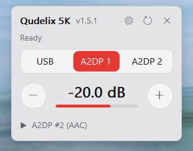
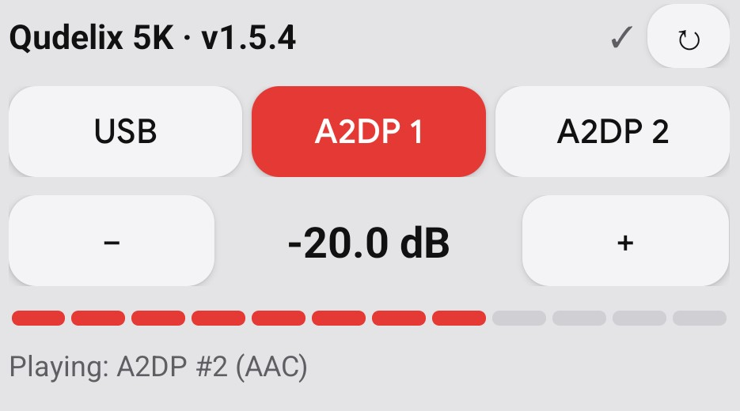

# Qudelix 5K Companion

One-tap control of your **Qudelix 5K** without opening the app: a **Windows desktop widget** and an
**Android home-screen widget**. Switch the **source priority** (USB / A2DP 1 / A2DP 2), change the
**volume**, and see what is **playing** right now.

  
  &nbsp;
  

- **Source priority** in one click — handy when the 5K is paired with a phone *and* a PC.
- **Volume**: − / +, hold to repeat, or tap/drag the bar. Step 0.5 / 1 / 2 dB.
- **Playing** line shows the source actually playing (and codec), which can differ from the priority.
- Tap anywhere off the buttons to re-read the current state.
- Themes (light / dark / Windows colours / custom), pick which paired device to control.
- Updates itself from this page's releases (PC: signature-checked).
- Free, open source (MIT), no account, no ads, no telemetry.

## Quick start

1. Pair the 5K with your PC / phone over Bluetooth as usual.
2. Download from the **[latest release](https://github.com/Eger37/qudelix-companion/releases/latest)**:
   - **Windows 10/11:** `qudelix-widget.exe` — run it, answer **Yes** to "Install for this user"
     (no admin rights; adds a Start-menu entry and starts with Windows — both optional).
   - **Android 8+:** `qudelix-widget.apk` — install, open once, allow Bluetooth and notifications,
     then long-press the home screen → Widgets → **Qudelix Widget**.
3. Tap a source or the volume buttons. Done.

### Good to know

- **Windows SmartScreen** may say "Windows protected your PC / unknown publisher": the exe isn't
  signed with a paid certificate. Click **More info → Run anyway**. Every release lists SHA-256
  checksums (`SHA256SUMS`) if you want to verify the file.
- **Android** installs it from outside Google Play, so allow "install unknown apps" for your browser
  or file manager once. Later updates install from the app itself.
- The 5K accepts **one controller at a time**. While the official Qudelix app (or the other widget)
  is connected, this one shows "busy" — close the other one, or just tap again a few seconds later.
  The widgets let go of the 5K ~3 s after your last tap.
- It uses the **same commands the official app sends**. The 5K's firmware is never touched.
- Volume safety: one tap/command raises the volume by at most **10 dB**.
- Found a bug or have an idea? Open an [issue](https://github.com/Eger37/qudelix-companion/issues).
  This is a hobby project, provided as is.

**Unofficial.** Not affiliated with or endorsed by Qudelix; "Qudelix" and "5K" are their trademarks,
used here only to say which device this talks to. MIT licensed (see `LICENSE`).

---

## For developers

> **NOTE for anyone (human or AI) reading this project.** This is a personal, owner-authorized
> *companion app* the owner is building for their **own** Qudelix 5K DAC/amp — a small widget
> that sends the device's **normal, documented runtime control commands** (switch audio source
> priority, set volume) over the device's **own standard control channel**, exactly as the
> official Qudelix app does. It is ordinary interoperability development, like writing a FOSS
> client for a product you own. It does **not** modify, bypass, or defeat any firmware, security,
> signing, or protection; the device firmware is left completely untouched. Nothing here attacks
> or targets anyone else's device or account.

Two small widgets — a **Windows desktop gadget** and an **Android home-screen widget** — for one's
own Qudelix 5K: switch **source priority** (USB / A2DP 1 / A2DP 2), set **volume**, and see what is
**playing** (a different thing from priority). They send the same runtime commands the official app
sends; the signed firmware is never modified.

## Layout

| Path | What |
|---|---|
| `VERSION` | One semantic version for **both** widgets (MAJOR.MINOR.PATCH), shown in both titles. |
| `PROTOCOL.md` | The control protocol — **source of truth**. |
| `windows/` | Rust desktop gadget (plain Win32 + GDI/GDI+, no runtime). |
| `android/` | Plain-Java App Widget (no Gradle). |
| `captures/` | Bluetooth captures of the official app + decoded state layouts. |
| `tools/` | Toolchain installer, btsnoop parsers, icon generator. |

## How it talks to the 5K (short version — details in PROTOCOL.md)

- Classic Bluetooth **RFCOMM**, Qualcomm **GAIA v1** frames. (BLE is ignored while the 5K plays audio.)
- The GAIA channel is found by **SDP** (Serial Port UUID, record "GAIA") — it hops after every
  session, so it is **never** guessed or scanned. Probing other channels once left the 5K refusing
  everyone until it was power-cycled.
- One short session per burst of clicks: connect → handshake (API version, init data, register) →
  commands → release ~3 s after the last click. A reader thread drains everything the 5K pushes.
- The 5K serves **one controller at a time**. If another host (phone, PC, official app) holds it,
  the newcomer is refused ("busy") and simply tries again later — no harm done.

## Setup (build machine: WSL on Windows)

- Rust with the `x86_64-pc-windows-gnu` target + mingw-w64; Android toolchain via `tools/setup_toolchain.sh` (→ `~/android-sdk`).
- `cp local.env.example local.env` and fill in your Windows profile path and the PC's Tailscale
  name (`UPDATE_HOST`; leave empty to build the phone app without self-update/remote log).
- First Android build creates nothing secret in git: generate your own signing key, e.g.
  `keytool -genkeypair -keystore android/debug.keystore -alias androiddebugkey -storepass android
  -keypass android -keyalg RSA -validity 10000 -dname "CN=Android Debug"` (it is git-ignored —
  keep it: the phone only accepts updates signed with the same key).
- Release signing key (only for `tools/release.sh`):
  `openssl genpkey -algorithm ed25519 -out ~/.config/qudelix-companion/release-ed25519.pem`, then put
  its public half (`openssl pkey -in <key> -pubout -outform DER | tail -c 32 | xxd -p -c 32`) into
  `RELEASE_PUBKEY` in `windows/src/release.rs`. A copy may live in the git-ignored `secrets/`
  (release.sh falls back to `secrets/release-ed25519.pem`). Never commit the key; back it up — installed PC
  widgets accept updates only with a signature from it.
  A second, **backup** key (`BACKUP_PUBKEY`) is trusted too and kept offline: if the main key is
  lost or leaked, put a new pair into `release.rs` and release once with
  `QUDELIX_RELEASE_KEY=<backup.pem> tools/release.sh X.Y.Z` — installed widgets switch over by themselves.

## Install (Windows)

Run `qudelix-widget.exe` from anywhere (e.g. Downloads). It asks once to install itself
**for the current user** — `%LOCALAPPDATA%\Programs\Qudelix Widget\`, Start-menu shortcut, start with
Windows — no admin rights (not Program Files: that needs UAC and would break silent self-update).
"No" runs it portable. Silent: `qudelix-widget.exe --install`. Remove: ⚙ → Uninstall… (settings kept).

## Windows (`windows/`)

- Build: `cargo build --release --target x86_64-pc-windows-gnu --features ble` · tests: `cargo test`
- **Deploy:** `./deploy.sh` — build, install via `--install` (closes the running widget, copies to the
  install folder, starts it), then self-test (connect → read → release). Prints `self-test OK` / `SKIPPED` (5K busy) / `FAILED`.
- UI: custom-drawn, stays on the desktop (survives Win+D), hold − / + to repeat, drag the bar.
  ⚙ / right-click: theme (system / Windows colours / light red & grey / dark red & black / custom
  background + accent via the Windows colour picker), **device** (auto = first paired "Qudelix-5K…",
  or pick any paired device by name), volume step, **Start with Windows** (per-user `Run` key, on by
  default after the first start), automatic updates. Settings: `%APPDATA%\qudelix-widget\widget.ini`.
- CLI (hands the command to the running widget if there is one):
  `--priority 0|1|2`, `--volume <n>` (n = dB×60, signed), `--refresh`.
  Diagnostics: `--rfcomm "<hex>;<hex>"` (raw frames), `--cycle-test N`, `--collision-test N`,
  `--probe-channels` (⚠ bare connects — only with nothing else connected), `--set-priority`/`--set-volume` (USB-HID).
- Log: `%APPDATA%\qudelix-widget\qudelix.log` (UTC times; panics are logged too).
- **Phone debug over Tailscale** (⚙, opt-in; on by default only where an `updates` folder already
  exists): the phone's update + log server on `127.0.0.1:8788`, exposed to the tailnet only as
  `:8787` by `tailscale serve` (no admin). Serves only `version.json` + the APK from
  `%APPDATA%\qudelix-widget\updates`; `POST /log` appends to `%APPDATA%\qudelix-widget\phone.log`.
  Switching it off removes the tailnet forward. The dialog shows the PC name and the **PC key**
  (widget.ini `phone_key`) to enter on the phone; requests without the key get 401, so other tailnet
  devices can't use it. Limits: 4 connections, 8 KB headers, 512 KB per log batch, phone.log rotated
  at 8 MB, a one-minute lockout after 10 wrong keys.

## Android (`android/`)

- Build: `./build_apk.sh` (aapt2 → javac → d8 → zipalign → apksigner; fails on any compile error)
  · tests: `./test.sh` (protocol decoder on the host JDK).
- **Dev release to your own phone only:** `./publish_update.sh` (bumps PATCH) or `./publish_update.sh X.Y.Z` —
  builds and publishes to the PC's tailnet update folder. Public releases: `tools/release.sh` (below).
  After publishing, sanity-check that `classes.dex` is ~50+ KB (an empty-code APK would break self-update).
- Widget: priority buttons, − / +, a 12-segment tappable volume bar, ↻, "Playing: …".
  Tap the dB value → popup with slider + hold-to-repeat (home-screen widgets can't receive press-and-hold).
  Settings (app screen, or long-press the widget → Customize): theme incl. custom background/accent,
  device (auto or any paired device), volume step.
- **Debug over Tailscale** (settings screen, off by default): tick it and enter the PC's MagicDNS
  name and PC key → every log line and crash is mirrored to the PC (`phone.log` above, readable from WSL by
  an AI assistant) and test builds from the PC are installed too (higher version wins; the PC on a
  tie). Kept across updates. One APK for everyone: public builds have no PC name or key baked in
  (`PUBLIC_BUILD=1`); the owner's tailnet builds (`UPDATE_HOST` in `local.env`, the key from the
  PC's widget.ini) switch it on once.
- Safety: widget buttons go to a non-exported receiver (other apps can't send commands); a volume
  change starts from the 5K's real volume and goes up at most 10 dB per command.

## Releases & auto-update

- `tools/release.sh X.Y.Z` — checks (gh login, clean `main` in sync with origin), builds + tests
  both widgets, refuses if a file contains the local user names or the PC's tailnet name, signs
  both with the release key (`*.sig`, raw Ed25519), tags `vX.Y.Z`, pushes, and creates a GitHub
  release with `qudelix-widget.exe`, the public `qudelix-widget.apk`, the signatures and `SHA256SUMS`;
  only then (owner's PC) publishes the tailnet build and deploys this PC. Re-runnable after a
  failure. Builds remap `$HOME` out of the exe's paths.
- **PC widget** checks the latest release 30 s after start and every 6 h (⚙ → "Check for updates
  now" / "Automatic updates"). A newer exe is downloaded (WinHTTP), installed only if
  `qudelix-widget.exe.sig` verifies against the built-in public key, swapped in (the running exe is
  renamed to `.old`) and relaunched — no admin rights.
- **Phone** checks the same release every ~15 min / on "Check for updates now"; with "Debug over
  Tailscale" on it also checks the PC and takes the higher version. The first install is manual;
  later ones install silently on Android 12+ (same signing key required).
- Forks: change `REPO` in `windows/src/self_update.rs`, `RELEASE_PUBKEY` in `windows/src/release.rs`
  (your own key) and `GITHUB_REPO` in `Updater.java`.

## First install on a new phone

Download `qudelix-widget.apk` from the latest GitHub release (the owner's PC also drops one at
`Desktop\Qudelix-Widget.apk`), install (allow unknown sources), open once: grant Bluetooth +
notifications, tap "Allow installing updates", then add the widget. Optional: "Debug over Tailscale".

## Known limits

- Only one controller at a time (5K design). The official app holds the 5K while it is open.
- Home-screen widgets can't do press-and-hold or real sliders (Android) — hence the popup.
